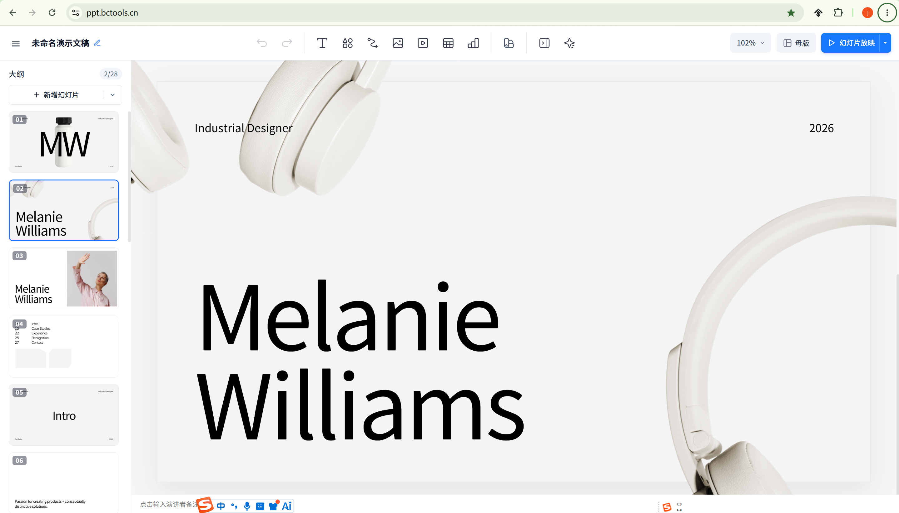
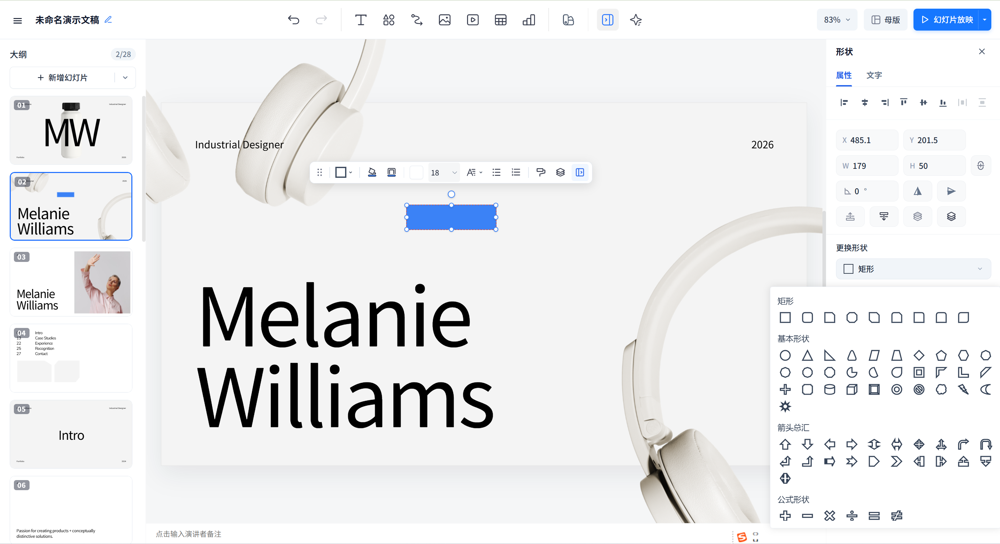
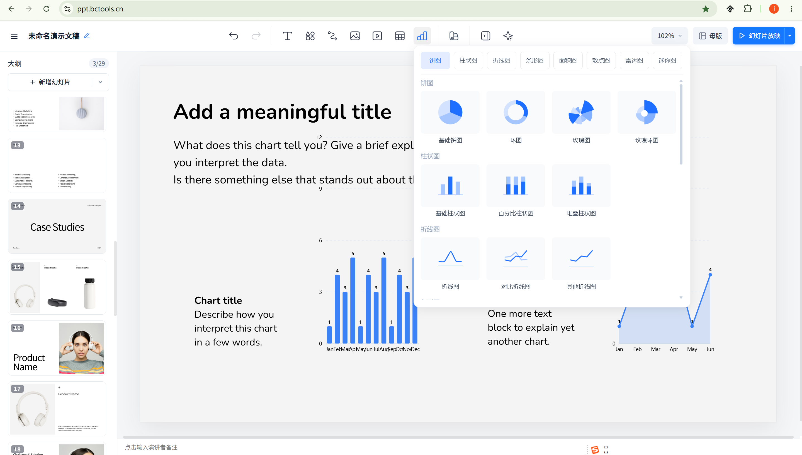
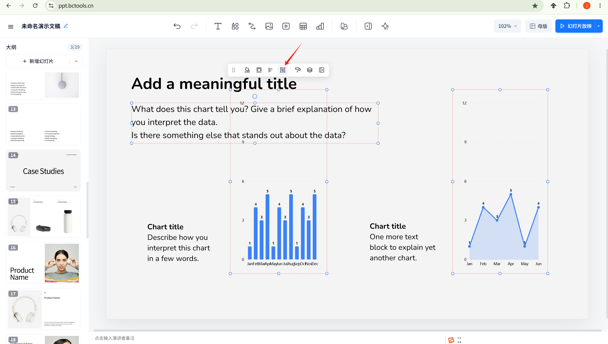
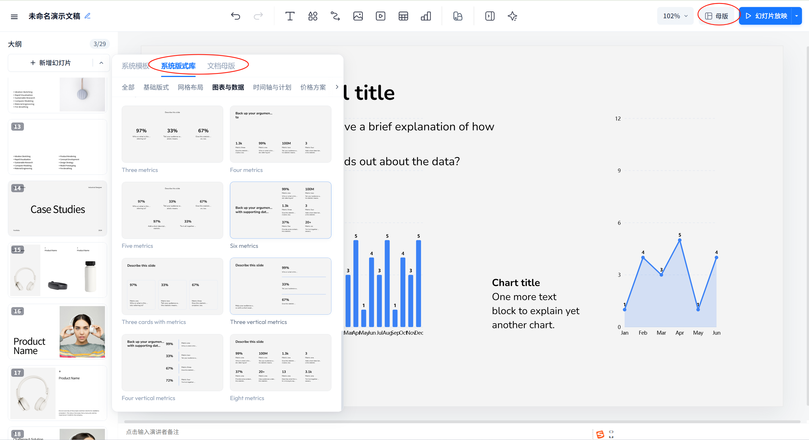
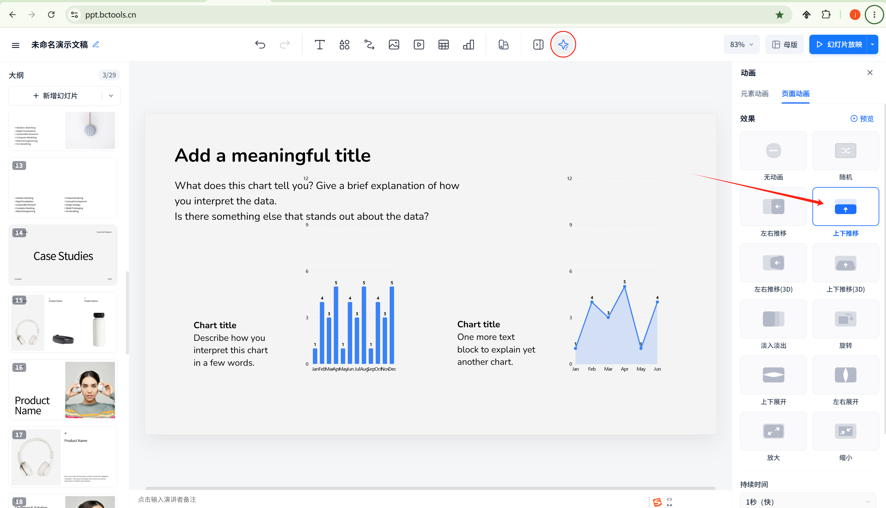
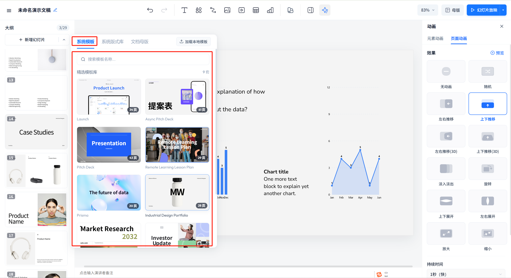

# JVS-PPT 

这是一个基于 Vue 3 + TypeScript + Vite 构建的 在线PPT编辑器。

## 项目特点

- **开箱即用**：`jvs-ppt-ui` 内置了完整的组件、样式与阿里巴巴 Iconfont SVG 图标库，无需在 `index.html` 中手动引入任何外部图标脚本。
- **功能示例**：包含一个完整的 `PptExample.vue` 组件，展示了：
  - 幻灯片工程数据的获取与保存 (`getSaveData`, `save`)。
  - 导出标准 `.pptx` 文件 (`exportPptx`)、新增页面 (`addSlide`) 与全屏放映 (`startPresentation`)。
  - 编辑模式与只读预览模式 (`readonly`) 的动态切换。
  - 自定义资源上传逻辑 (`customUpload`) 的配置。
- **全屏适配**：优化了布局，确保 PPT 编辑器区域能够完美填充浏览器视口。

### 基础编辑能力

- 幻灯片管理：新增、复制、删除、排序、分组、隐藏幻灯片

- 基础元素：文本框、形状、线条、图片、表格、基础图表（柱状 / 折线 / 饼图）


- 图层管理：层级、组合、取消组合、对齐分布、等距、批量尺寸统一

- 母版 / 版式编辑：管理员维护母版，普通用户仅可选用

- 备注页、演讲备注
- 基础动画、页面切换（轻量化，不主打复杂动画）

- 在线协同：多人同时编辑、光标显示、评论批注
- 预览模式：网页端直接放映演示
- 系统提供内置模板



我们除了提供本项目，相关的项目演示地址如下：

- 管理平台（含管理平台）：https://frame.bctools.cn/
- 低代码开发平台：https://app.bctools.cn/
- 数据智仓（数据分析平台）：http://bi.bctools.cn/
- 物联网平台：http://iot.bctools.cn/
- AI套件：https://ai.bctools.cn/
- 规则引擎：http://rules.bctools.cn/
- 逻辑引擎：http://logic.bctools.cn/
- APS（智能排产）：https://aps.bctools.cn/
- 视频会议：http://meeting.bctools.cn/
- 企业文档：http://knowledge.bctools.cn/
- 企业计划（项目管理）：http://teamwork.bctools.cn/
- md编辑器插件：http://md.bctools.cn/
- PPT编辑器插件：http://ppt.bctools.cn/
- Excel编辑器插件：http://excel.bctools.cn/
- 在线白板插件：http://draw.bctools.cn/
- 企业邮筒（Web邮箱客户端）：http://mailbox.bctools.cn/
- 智能调度：https://rss.bctools.cn
- SPC：https://spc.bctools.cn

试用账号：微信扫码即可登陆，如需要账号密码试用，请二维码联系我们 技术交流与商务支持


## 快速开始

### 1. 安装依赖

```bash
npm install
```

### 2. 启动开发服务器

```bash
npm run dev
```

项目默认运行在 `http://localhost:10012`。

## 核心配置说明

### 全局引入 (main.ts)

项目在 `main.ts` 中完成了以下配置：
- 引入 `jvs-ppt-ui` 核心插件及 `jvs-ppt-ui/dist/lib/style.css` 样式。
- 引入 `Element Plus` 用于示例页面顶部外部操作栏。

